# Database Schema from InitialCreate Migration

## COHORTS

| STT | Tên cột | Kiểu dữ liệu | Ràng buộc |
|---:|---|---|---|
| 1 | ID | NUMBER(10) | PK; Not null |
| 2 | COHORT_CODE | NVARCHAR2(50) | Not null |
| 3 | COHORT_NAME | NVARCHAR2(255) | Not null |
| 4 | START_YEAR | NUMBER(10) | Not null |
| 5 | END_YEAR | NUMBER(10) | Not null |
| 6 | STATUS | NUMBER(10) | Not null; Default: 1 |
| 7 | CREATED_AT | TIMESTAMP(7) | Allow null; Default: SYSTIMESTAMP |
| 8 | UPDATED_AT | TIMESTAMP(7) | Allow null; Default: SYSTIMESTAMP |

## COMMITTEECODERESERVATIONS

| STT | Tên cột | Kiểu dữ liệu | Ràng buộc |
|---:|---|---|---|
| 1 | COMMITTEECODERESERVATIONID | NUMBER(10) | PK; Not null |
| 2 | PERIODID | NUMBER(10) | Not null |
| 3 | YEAR | NUMBER(10) | Not null |
| 4 | SEQUENCE | NUMBER(10) | Not null |
| 5 | COMMITTEECODE | NVARCHAR2(40) | Not null |
| 6 | STATUS | NVARCHAR2(20) | Not null |
| 7 | REQUESTKEY | NVARCHAR2(200) | Allow null |
| 8 | RESERVEDAT | TIMESTAMP(7) | Not null; Default: SYSTIMESTAMP |
| 9 | EXPIRESAT | TIMESTAMP(7) | Not null |
| 10 | COMMITTEDAT | TIMESTAMP(7) | Allow null |

## DEFENSEGROUPS

| STT | Tên cột | Kiểu dữ liệu | Ràng buộc |
|---:|---|---|---|
| 1 | DEFENSEGROUPID | NUMBER(10) | PK; Not null |
| 2 | TERMID | NUMBER(10) | Not null |
| 3 | SLOTID | NVARCHAR2(80) | Not null |
| 4 | STUDENTCODESJSON | NVARCHAR2(2000) | Not null |
| 5 | CREATEDAT | TIMESTAMP(7) | Not null; Default: SYSTIMESTAMP |

## DEFENSETERMS

| STT | Tên cột | Kiểu dữ liệu | Ràng buộc |
|---:|---|---|---|
| 1 | DEFENSETERMID | NUMBER(10) | PK; Not null |
| 2 | TERMCODE | NVARCHAR2(50) | Allow null |
| 3 | NAME | NVARCHAR2(200) | Not null |
| 4 | DESCRIPTION | NVARCHAR2(2000) | Allow null |
| 5 | ACADEMICYEAR | NVARCHAR2(20) | Allow null |
| 6 | SEMESTER | NVARCHAR2(20) | Allow null |
| 7 | STARTDATE | TIMESTAMP(7) | Not null |
| 8 | ENDDATE | TIMESTAMP(7) | Allow null |
| 9 | CONFIGJSON | NVARCHAR2(2000) | Allow null |
| 10 | STATUS | NVARCHAR2(30) | Not null; Default: "Draft" |
| 11 | CREATEDAT | TIMESTAMP(7) | Not null; Default: SYSTIMESTAMP |
| 12 | LASTUPDATED | TIMESTAMP(7) | Not null; Default: SYSTIMESTAMP |

## DEPARTMENTS

| STT | Tên cột | Kiểu dữ liệu | Ràng buộc |
|---:|---|---|---|
| 1 | DEPARTMENTID | NUMBER(10) | PK; Not null |
| 2 | DEPARTMENTCODE | NVARCHAR2(30) | Not null |
| 3 | NAME | NVARCHAR2(200) | Not null |
| 4 | DESCRIPTION | NVARCHAR2(2000) | Allow null |
| 5 | CREATEDAT | TIMESTAMP(7) | Not null; Default: SYSTIMESTAMP |
| 6 | LASTUPDATED | TIMESTAMP(7) | Not null; Default: SYSTIMESTAMP |

## EXPORTFILES

| STT | Tên cột | Kiểu dữ liệu | Ràng buộc |
|---:|---|---|---|
| 1 | EXPORTFILEID | NUMBER(10) | PK; Not null |
| 2 | FILECODE | NVARCHAR2(40) | Not null |
| 3 | TERMID | NUMBER(10) | Not null |
| 4 | STATUS | NVARCHAR2(30) | Not null; Default: "Running" |
| 5 | FILEURL | NVARCHAR2(500) | Allow null |
| 6 | CREATEDAT | TIMESTAMP(7) | Not null; Default: SYSTIMESTAMP |

## IDEMPOTENCY_RECORDS

| STT | Tên cột | Kiểu dữ liệu | Ràng buộc |
|---:|---|---|---|
| 1 | IDEMPOTENCY_RECORD_ID | NUMBER(10) | PK; Not null |
| 2 | ACTION | NVARCHAR2(80) | Not null |
| 3 | PERIOD_ID | NUMBER(10) | Not null |
| 4 | REQUEST_KEY | NVARCHAR2(200) | Not null |
| 5 | REQUEST_HASH | NVARCHAR2(128) | Not null |
| 6 | RESPONSE_PAYLOAD | CLOB | Allow null |
| 7 | RESPONSE_STATUS_CODE | NUMBER(10) | Allow null |
| 8 | RESPONSE_SUCCESS | NUMBER(1) | Allow null |
| 9 | RECORD_STATUS | NUMBER(10) | Not null; Default: 0 |
| 10 | CREATED_AT | TIMESTAMP(7) | Not null; Default: SYSTIMESTAMP |
| 11 | EXPIRES_AT | TIMESTAMP(7) | Not null |
| 12 | COMPLETED_AT | TIMESTAMP(7) | Allow null |

## LECTURERDASHBOARDVIEW

| STT | Tên cột | Kiểu dữ liệu | Ràng buộc |
|---:|---|---|---|
| 1 | LECTURERPROFILEID | NUMBER(10) | Not null |
| 2 | LECTURERCODE | NVARCHAR2(2000) | Not null |
| 3 | FULLNAME | NVARCHAR2(2000) | Allow null |
| 4 | DEPARTMENTCODE | NVARCHAR2(2000) | Allow null |
| 5 | DEGREE | NVARCHAR2(2000) | Allow null |
| 6 | GUIDEQUOTA | NUMBER(10) | Not null |
| 7 | DEFENSEQUOTA | NUMBER(10) | Not null |
| 8 | EMAIL | NVARCHAR2(2000) | Allow null |
| 9 | PHONENUMBER | NVARCHAR2(2000) | Allow null |
| 10 | PROFILEIMAGE | NVARCHAR2(2000) | Allow null |
| 11 | CURRENTGUIDINGCOUNT | NUMBER(10) | Not null |

## MILESTONETEMPLATES

| STT | Tên cột | Kiểu dữ liệu | Ràng buộc |
|---:|---|---|---|
| 1 | MILESTONETEMPLATEID | NUMBER(10) | PK; Not null |
| 2 | MILESTONETEMPLATECODE | NVARCHAR2(40) | Not null |
| 3 | NAME | NVARCHAR2(200) | Not null |
| 4 | DESCRIPTION | NVARCHAR2(2000) | Allow null |
| 5 | Ordinal | NUMBER(10) | Not null |
| 6 | DEADLINE | TIMESTAMP(7) | Allow null |
| 7 | CREATEDAT | TIMESTAMP(7) | Not null; Default: SYSTIMESTAMP |
| 8 | LASTUPDATED | TIMESTAMP(7) | Allow null |

## NOTIFICATION_OUTBOX

| STT | Tên cột | Kiểu dữ liệu | Ràng buộc |
|---:|---|---|---|
| 1 | OUTBOX_ID | NUMBER(10) | PK; Not null |
| 2 | EVENT_TYPE | NVARCHAR2(50) | Not null |
| 3 | PAYLOAD_JSON | NVARCHAR2(2000) | Not null |
| 4 | OUTBOX_STATUS | NVARCHAR2(20) | Not null; Default: "PENDING" |
| 5 | RETRY_COUNT | NUMBER(10) | Not null; Default: 0 |
| 6 | NEXT_RETRY_AT | TIMESTAMP(7) | Allow null |
| 7 | LAST_ERROR | NVARCHAR2(1000) | Allow null |
| 8 | CREATED_AT | TIMESTAMP(7) | Not null; Default: SYSTIMESTAMP |
| 9 | PROCESSED_AT | TIMESTAMP(7) | Allow null |

## NOTIFICATIONS

| STT | Tên cột | Kiểu dữ liệu | Ràng buộc |
|---:|---|---|---|
| 1 | NOTIFICATION_ID | NUMBER(10) | PK; Not null |
| 2 | NOTIFICATION_CODE | NVARCHAR2(60) | Not null |
| 3 | NOTIF_CHANNEL | NVARCHAR2(20) | Not null |
| 4 | NOTIF_CATEGORY | NVARCHAR2(40) | Not null |
| 5 | NOTIF_TITLE | NVARCHAR2(255) | Not null |
| 6 | NOTIF_BODY | NVARCHAR2(2000) | Not null |
| 7 | NOTIF_PRIORITY | NVARCHAR2(20) | Not null |
| 8 | ACTION_TYPE | NVARCHAR2(30) | Allow null |
| 9 | ACTION_URL | NVARCHAR2(500) | Allow null |
| 10 | IMAGE_URL | NVARCHAR2(500) | Allow null |
| 11 | RELATED_ENTITY_NAME | NVARCHAR2(100) | Allow null |
| 12 | RELATED_ENTITY_CODE | NVARCHAR2(60) | Allow null |
| 13 | RELATED_ENTITY_ID | NUMBER(10) | Allow null |
| 14 | TRIGGERED_BY_USER_ID | NUMBER(10) | Allow null |
| 15 | TRIGGERED_BY_USER_CODE | NVARCHAR2(40) | Allow null |
| 16 | IS_GLOBAL | NUMBER(10) | Not null; Default: 0 |
| 17 | SCHEDULE_AT | TIMESTAMP(7) | Allow null |
| 18 | EXPIRES_AT | TIMESTAMP(7) | Allow null |
| 19 | CREATED_AT | TIMESTAMP(7) | Not null; Default: SYSTIMESTAMP |
| 20 | UPDATED_AT | TIMESTAMP(7) | Allow null |

## ROOMS

| STT | Tên cột | Kiểu dữ liệu | Ràng buộc |
|---:|---|---|---|
| 1 | ROOM_ID | NUMBER(10) | PK; Not null |
| 2 | ROOM_CODE | NVARCHAR2(40) | Not null |
| 3 | ROOM_STATUS | NVARCHAR2(50) | Allow null |
| 4 | CREATED_AT | TIMESTAMP(7) | Not null; Default: SYSTIMESTAMP |
| 5 | LAST_UPDATED | TIMESTAMP(7) | Not null; Default: SYSTIMESTAMP |

## SYNCAUDITLOGS

| STT | Tên cột | Kiểu dữ liệu | Ràng buộc |
|---:|---|---|---|
| 1 | SYNCAUDITLOGID | NUMBER(10) | PK; Not null |
| 2 | TIMESTAMP | TIMESTAMP(7) | Not null; Default: SYSTIMESTAMP |
| 3 | ACTION | NVARCHAR2(150) | Not null |
| 4 | RESULT | NVARCHAR2(50) | Not null |
| 5 | RECORDS | NCLOB | Not null |

## TAGS

| STT | Tên cột | Kiểu dữ liệu | Ràng buộc |
|---:|---|---|---|
| 1 | TAGID | NUMBER(10) | PK; Not null |
| 2 | TAGCODE | NVARCHAR2(40) | Not null |
| 3 | TAGNAME | NVARCHAR2(100) | Not null |
| 4 | DESCRIPTION | NVARCHAR2(500) | Allow null |
| 5 | CREATEDAT | TIMESTAMP(7) | Not null; Default: SYSTIMESTAMP |

## TOPIC_WORKFLOW_AUDITS

| STT | Tên cột | Kiểu dữ liệu | Ràng buộc |
|---:|---|---|---|
| 1 | AUDIT_ID | NUMBER(19) | PK; Not null |
| 2 | AUDIT_CODE | NVARCHAR2(50) | Not null |
| 3 | MODULE_NAME | NVARCHAR2(50) | Not null |
| 4 | WORKFLOW_NAME | NVARCHAR2(100) | Not null |
| 5 | ACTION_TYPE | NVARCHAR2(30) | Not null |
| 6 | DECISION_ACTION | NVARCHAR2(30) | Allow null |
| 7 | TOPIC_ID | NUMBER(10) | Allow null |
| 8 | TOPIC_CODE | NVARCHAR2(60) | Allow null |
| 9 | ENTITY_NAME | NVARCHAR2(100) | Allow null |
| 10 | ENTITY_ID | NVARCHAR2(60) | Allow null |
| 11 | ENTITY_CODE | NVARCHAR2(60) | Allow null |
| 12 | OLD_STATUS | NVARCHAR2(50) | Allow null |
| 13 | NEW_STATUS | NVARCHAR2(50) | Allow null |
| 14 | STATUS_CODE | NVARCHAR2(30) | Allow null |
| 15 | RESUBMIT_COUNT_BEFORE | NUMBER(10) | Allow null |
| 16 | RESUBMIT_COUNT_AFTER | NUMBER(10) | Allow null |
| 17 | COMMENT_TEXT | NVARCHAR2(2000) | Allow null |
| 18 | ERROR_MESSAGE | NVARCHAR2(2000) | Allow null |
| 19 | IS_SUCCESS | NUMBER(10) | Not null; Default: 1 |
| 20 | REQUEST_PAYLOAD | NVARCHAR2(2000) | Allow null |
| 21 | RESPONSE_PAYLOAD | NVARCHAR2(2000) | Allow null |
| 22 | CHANGED_FIELDS | NVARCHAR2(2000) | Allow null |
| 23 | TAGS_BEFORE | NVARCHAR2(2000) | Allow null |
| 24 | TAGS_AFTER | NVARCHAR2(2000) | Allow null |
| 25 | MILESTONE_BEFORE | NVARCHAR2(2000) | Allow null |
| 26 | MILESTONE_AFTER | NVARCHAR2(2000) | Allow null |
| 27 | ACTOR_USER_ID | NUMBER(10) | Allow null |
| 28 | ACTOR_USER_CODE | NVARCHAR2(60) | Allow null |
| 29 | ACTOR_ROLE | NVARCHAR2(40) | Allow null |
| 30 | REVIEWER_USER_ID | NUMBER(10) | Allow null |
| 31 | REVIEWER_USER_CODE | NVARCHAR2(60) | Allow null |
| 32 | CORRELATION_ID | NVARCHAR2(100) | Allow null |
| 33 | IDEMPOTENCY_KEY | NVARCHAR2(100) | Allow null |
| 34 | REQUEST_ID | NVARCHAR2(100) | Allow null |
| 35 | IP_ADDRESS | NVARCHAR2(64) | Allow null |
| 36 | USER_AGENT | NVARCHAR2(500) | Allow null |
| 37 | DEVICE_INFO | NVARCHAR2(500) | Allow null |
| 38 | CREATED_AT | TIMESTAMP(7) | Not null; Default: SYSTIMESTAMP |

## Users

| STT | Tên cột | Kiểu dữ liệu | Ràng buộc |
|---:|---|---|---|
| 1 | USERID | NUMBER(10) | PK; Not null |
| 2 | USERCODE | NVARCHAR2(40) | Not null |
| 3 | PASSWORDHASH | NVARCHAR2(255) | Not null |
| 4 | Role | NVARCHAR2(20) | Not null |
| 5 | CREATEDAT | TIMESTAMP(7) | Not null; Default: SYSTIMESTAMP |
| 6 | LASTUPDATED | TIMESTAMP(7) | Not null; Default: SYSTIMESTAMP |

## COMMITTEES

| STT | Tên cột | Kiểu dữ liệu | Ràng buộc |
|---:|---|---|---|
| 1 | COMMITTEEID | NUMBER(10) | PK; Not null |
| 2 | COMMITTEECODE | NVARCHAR2(40) | Not null |
| 3 | NAME | NVARCHAR2(200) | Allow null |
| 4 | DEFENSEDATE | TIMESTAMP(7) | Allow null |
| 5 | ROOM | NVARCHAR2(40) | Allow null |
| 6 | DEFENSETERMID | NUMBER(10) | Allow null; FK -> DEFENSETERMS.DEFENSETERMID |
| 7 | CREATEDAT | TIMESTAMP(7) | Not null; Default: SYSTIMESTAMP |
| 8 | LASTUPDATED | TIMESTAMP(7) | Not null; Default: SYSTIMESTAMP |
| 9 | STATUS | NVARCHAR2(50) | Allow null |

## CATALOGTOPICS

| STT | Tên cột | Kiểu dữ liệu | Ràng buộc |
|---:|---|---|---|
| 1 | CATALOGTOPICID | NUMBER(10) | PK; Not null |
| 2 | CATALOGTOPICCODE | NVARCHAR2(40) | Not null |
| 3 | TITLE | NVARCHAR2(255) | Not null |
| 4 | SUMMARY | NVARCHAR2(1000) | Allow null |
| 5 | DEPARTMENTID | NUMBER(10) | Allow null |
| 6 | DEPARTMENTCODE | NVARCHAR2(30) | Allow null; FK -> DEPARTMENTS.DEPARTMENTCODE |
| 7 | ASSIGNEDSTATUS | NVARCHAR2(20) | Allow null |
| 8 | ASSIGNEDAT | TIMESTAMP(7) | Allow null |
| 9 | CREATEDAT | TIMESTAMP(7) | Allow null; Default: SYSTIMESTAMP |
| 10 | LASTUPDATED | TIMESTAMP(7) | Allow null; Default: SYSTIMESTAMP |

## CLASSES

| STT | Tên cột | Kiểu dữ liệu | Ràng buộc |
|---:|---|---|---|
| 1 | CLASSID | NUMBER(10) | PK; Not null |
| 2 | CLASSCODE | NVARCHAR2(30) | Not null |
| 3 | CLASSNAME | NVARCHAR2(150) | Not null |
| 4 | DEPARTMENTID | NUMBER(10) | Not null; FK -> DEPARTMENTS.DEPARTMENTID |
| 5 | DEPARTMENTCODE | NVARCHAR2(30) | Allow null |
| 6 | COHORT_CODE | NVARCHAR2(50) | Allow null |
| 7 | ENROLLMENTYEAR | NUMBER(10) | Allow null |
| 8 | STATUS | NVARCHAR2(30) | Allow null; Default: "Đang hoạt động" |
| 9 | CREATEDAT | TIMESTAMP(7) | Allow null; Default: SYSTIMESTAMP |
| 10 | LASTUPDATED | TIMESTAMP(7) | Allow null |

## CHAT_SESSIONS

| STT | Tên cột | Kiểu dữ liệu | Ràng buộc |
|---:|---|---|---|
| 1 | CHAT_SESSION_ID | NUMBER(10) | PK; Not null |
| 2 | USER_ID | NUMBER(10) | Not null; FK -> Users.USERID |
| 3 | TITLE | NVARCHAR2(200) | Allow null |
| 4 | MODEL_NAME | NVARCHAR2(50) | Allow null |
| 5 | CREATED_AT | TIMESTAMP(7) | Not null; Default: SYSTIMESTAMP |
| 6 | IS_ARCHIVED | NUMBER(10) | Not null; Default: 0 |

## CONVERSATIONS

| STT | Tên cột | Kiểu dữ liệu | Ràng buộc |
|---:|---|---|---|
| 1 | CONVERSATIONID | NUMBER(10) | PK; Not null |
| 2 | CONVERSATIONCODE | NVARCHAR2(50) | Not null |
| 3 | CONVERSATIONTYPE | NVARCHAR2(20) | Not null |
| 4 | TITLE | NVARCHAR2(200) | Allow null |
| 5 | CREATEDBYUSERID | NUMBER(10) | Not null; FK -> Users.USERID |
| 6 | CREATEDBYUSERCODE | NVARCHAR2(40) | Allow null |
| 7 | AVATARURL | NVARCHAR2(500) | Allow null |
| 8 | LASTMESSAGEID | NUMBER(10) | Allow null |
| 9 | LASTMESSAGEPREVIEW | NVARCHAR2(500) | Allow null |
| 10 | LASTMESSAGEAT | TIMESTAMP(7) | Allow null |
| 11 | ISARCHIVED | NUMBER(10) | Not null; Default: 0 |
| 12 | CREATEDAT | TIMESTAMP(7) | Allow null; Default: SYSTIMESTAMP |
| 13 | LASTUPDATED | TIMESTAMP(7) | Allow null |

## DEFENSESCORES

| STT | Tên cột | Kiểu dữ liệu | Ràng buộc |
|---:|---|---|---|
| 1 | SCOREID | NUMBER(10) | PK; Not null |
| 2 | SCORECODE | NVARCHAR2(60) | Not null |
| 3 | ASSIGNMENTID | NUMBER(10) | Not null |
| 4 | ASSIGNMENTCODE | NVARCHAR2(60) | Allow null |
| 5 | MEMBERLECTURERPROFILEID | NUMBER(10) | Allow null |
| 6 | MEMBERLECTURERCODE | NVARCHAR2(30) | Allow null |
| 7 | MEMBERLECTURERUSERID | NUMBER(10) | Allow null |
| 8 | MEMBERLECTURERUSERCODE | NVARCHAR2(40) | Allow null; FK -> Users.USERCODE |
| 9 | SCORE | NUMBER(5,2) | Not null |
| 10 | Comment | NVARCHAR2(2000) | Allow null |
| 11 | ISSUBMITTED | NUMBER(10) | Not null; Default: 0 |
| 12 | REVISION_REQUIRED | NUMBER(10) | Not null; Default: 0 |
| 13 | REVISION_REASON | NVARCHAR2(1000) | Allow null |
| 14 | REVISION_DEADLINE_DAYS | NUMBER(10) | Allow null |
| 15 | CREATEDAT | TIMESTAMP(7) | Allow null; Default: SYSTIMESTAMP |
| 16 | LASTUPDATED | TIMESTAMP(7) | Allow null; Default: SYSTIMESTAMP |

## LECTURERPROFILES

| STT | Tên cột | Kiểu dữ liệu | Ràng buộc |
|---:|---|---|---|
| 1 | LECTURERPROFILEID | NUMBER(10) | PK; Not null |
| 2 | LECTURERCODE | NVARCHAR2(30) | Not null |
| 3 | USERID | NUMBER(10) | Not null |
| 4 | USERCODE | NVARCHAR2(40) | Allow null; FK -> Users.USERCODE |
| 5 | DEPARTMENTID | NUMBER(10) | Allow null |
| 6 | DEPARTMENTCODE | NVARCHAR2(30) | Allow null; FK -> DEPARTMENTS.DEPARTMENTCODE |
| 7 | DEGREE | NVARCHAR2(50) | Allow null |
| 8 | SPECIALTIES | NVARCHAR2(500) | Allow null |
| 9 | FULLNAME | NVARCHAR2(100) | Allow null |
| 10 | ORGANIZATION | NVARCHAR2(255) | Allow null |
| 11 | GUIDEQUOTA | NUMBER(10) | Allow null; Default: 10 |
| 12 | DEFENSEQUOTA | NUMBER(10) | Allow null; Default: 8 |
| 13 | CURRENTGUIDINGCOUNT | NUMBER(10) | Not null; Default: 0 |
| 14 | GENDER | NVARCHAR2(10) | Allow null |
| 15 | DATEOFBIRTH | date | Allow null |
| 16 | EMAIL | NVARCHAR2(100) | Allow null |
| 17 | PHONENUMBER | NVARCHAR2(20) | Allow null |
| 18 | PROFILEIMAGE | NVARCHAR2(255) | Allow null |
| 19 | ADDRESS | NVARCHAR2(255) | Allow null |
| 20 | NOTES | NVARCHAR2(2000) | Allow null |
| 21 | CREATEDAT | TIMESTAMP(7) | Allow null; Default: SYSTIMESTAMP |
| 22 | LASTUPDATED | TIMESTAMP(7) | Allow null; Default: SYSTIMESTAMP |

## NOTIFICATION_PREFERENCES

| STT | Tên cột | Kiểu dữ liệu | Ràng buộc |
|---:|---|---|---|
| 1 | PREFERENCE_ID | NUMBER(10) | PK; Not null |
| 2 | TARGET_USER_ID | NUMBER(10) | Not null; FK -> Users.USERID |
| 3 | TARGET_USER_CODE | NVARCHAR2(40) | Not null |
| 4 | NOTIF_CATEGORY | NVARCHAR2(40) | Not null |
| 5 | IN_APP_ENABLED | NUMBER(10) | Not null; Default: 1 |
| 6 | EMAIL_ENABLED | NUMBER(10) | Not null; Default: 0 |
| 7 | PUSH_ENABLED | NUMBER(10) | Not null; Default: 0 |
| 8 | DIGEST_MODE | NVARCHAR2(20) | Not null; Default: "IMMEDIATE" |
| 9 | QUIET_FROM | NVARCHAR2(5) | Allow null |
| 10 | QUIET_TO | NVARCHAR2(5) | Allow null |
| 11 | UPDATED_AT | TIMESTAMP(7) | Allow null |

## NOTIFICATION_RECIPIENTS

| STT | Tên cột | Kiểu dữ liệu | Ràng buộc |
|---:|---|---|---|
| 1 | RECIPIENT_ID | NUMBER(10) | PK; Not null |
| 2 | NOTIFICATION_ID | NUMBER(10) | Not null; FK -> NOTIFICATIONS.NOTIFICATION_ID |
| 3 | TARGET_USER_ID | NUMBER(10) | Not null; FK -> Users.USERID |
| 4 | TARGET_USER_CODE | NVARCHAR2(40) | Not null |
| 5 | DELIVERY_STATE | NVARCHAR2(20) | Not null; Default: "PENDING" |
| 6 | IS_READ | NUMBER(10) | Not null; Default: 0 |
| 7 | READ_AT | TIMESTAMP(7) | Allow null |
| 8 | SEEN_AT | TIMESTAMP(7) | Allow null |
| 9 | DISMISSED_AT | TIMESTAMP(7) | Allow null |
| 10 | DELIVERED_AT | TIMESTAMP(7) | Allow null |
| 11 | ERROR_MESSAGE | NVARCHAR2(1000) | Allow null |
| 12 | CREATED_AT | TIMESTAMP(7) | Not null; Default: SYSTIMESTAMP |
| 13 | UPDATED_AT | TIMESTAMP(7) | Allow null |

## SYSTEMACTIVITYLOGS

| STT | Tên cột | Kiểu dữ liệu | Ràng buộc |
|---:|---|---|---|
| 1 | LOGID | NUMBER(10) | PK; Not null |
| 2 | ENTITYNAME | NVARCHAR2(100) | Allow null |
| 3 | ENTITYID | NVARCHAR2(60) | Allow null |
| 4 | ACTIONTYPE | NVARCHAR2(30) | Not null |
| 5 | ACTIONDESCRIPTION | NVARCHAR2(2000) | Allow null |
| 6 | OLDVALUE | NVARCHAR2(2000) | Allow null |
| 7 | NEWVALUE | NVARCHAR2(2000) | Allow null |
| 8 | USERID | NUMBER(10) | Allow null; FK -> Users.USERID |
| 9 | USERCODE | NVARCHAR2(40) | Allow null |
| 10 | USERROLE | NVARCHAR2(30) | Allow null |
| 11 | IPADDRESS | NVARCHAR2(45) | Allow null |
| 12 | DEVICEINFO | NVARCHAR2(255) | Allow null |
| 13 | MODULE | NVARCHAR2(100) | Allow null |
| 14 | PERFORMEDAT | TIMESTAMP(7) | Not null; Default: SYSTIMESTAMP |
| 15 | STATUS | NVARCHAR2(30) | Allow null |
| 16 | RELATEDRECORDCODE | NVARCHAR2(60) | Allow null |
| 17 | Comment | NVARCHAR2(2000) | Allow null |

## COMMITTEESESSIONS

| STT | Tên cột | Kiểu dữ liệu | Ràng buộc |
|---:|---|---|---|
| 1 | COMMITTEESESSIONID | NUMBER(10) | PK; Not null |
| 2 | COMMITTEEID | NUMBER(10) | Not null |
| 3 | COMMITTEECODE | NVARCHAR2(40) | Not null; FK -> COMMITTEES.COMMITTEECODE |
| 4 | SESSIONNUMBER | NUMBER(10) | Not null |
| 5 | SCHEDULEDAT | TIMESTAMP(7) | Allow null |
| 6 | TOPICCOUNT | NUMBER(10) | Not null; Default: 0 |
| 7 | CREATEDAT | TIMESTAMP(7) | Not null; Default: SYSTIMESTAMP |
| 8 | LASTUPDATED | TIMESTAMP(7) | Not null; Default: SYSTIMESTAMP |

## COMMITTEETAGS

| STT | Tên cột | Kiểu dữ liệu | Ràng buộc |
|---:|---|---|---|
| 1 | COMMITTEETAGID | NUMBER(10) | PK; Not null |
| 2 | COMMITTEEID | NUMBER(10) | Not null; FK -> COMMITTEES.COMMITTEEID |
| 3 | COMMITTEECODE | NVARCHAR2(50) | Not null |
| 4 | TAGID | NUMBER(10) | Not null; FK -> TAGS.TAGID |
| 5 | TAGCODE | NVARCHAR2(50) | Not null |
| 6 | CREATEDAT | TIMESTAMP(7) | Not null; Default: SYSTIMESTAMP |

## CATALOGTOPICTAGS

| STT | Tên cột | Kiểu dữ liệu | Ràng buộc |
|---:|---|---|---|
| 1 | CATALOGTOPICID | NUMBER(10) | PK; Not null; FK -> CATALOGTOPICS.CATALOGTOPICID |
| 2 | TAGID | NUMBER(10) | Not null; FK -> TAGS.TAGID |
| 3 | CATALOGTOPICCODE | NVARCHAR2(2000) | Allow null |
| 4 | TAGCODE | NVARCHAR2(2000) | Allow null |
| 5 | CREATEDAT | TIMESTAMP(7) | Not null; Default: SYSTIMESTAMP |

## TOPICS

| STT | Tên cột | Kiểu dữ liệu | Ràng buộc |
|---:|---|---|---|
| 1 | TOPICID | NUMBER(10) | PK; Not null |
| 2 | TOPICCODE | NVARCHAR2(40) | Not null |
| 3 | TITLE | NVARCHAR2(200) | Not null |
| 4 | SUMMARY | NVARCHAR2(1000) | Allow null |
| 5 | Type | NVARCHAR2(20) | Not null |
| 6 | PROPOSERUSERID | NUMBER(10) | Not null |
| 7 | PROPOSERUSERCODE | NVARCHAR2(40) | Allow null; FK -> Users.USERCODE |
| 8 | PROPOSERSTUDENTCODE | NVARCHAR2(30) | Allow null |
| 9 | PROPOSERSTUDENTPROFILEID | NUMBER(10) | Allow null |
| 10 | SUPERVISORUSERID | NUMBER(10) | Allow null |
| 11 | SUPERVISORUSERCODE | NVARCHAR2(40) | Allow null |
| 12 | SUPERVISORLECTURERCODE | NVARCHAR2(30) | Allow null |
| 13 | SUPERVISORLECTURERPROFILEID | NUMBER(10) | Allow null |
| 14 | CATALOGTOPICID | NUMBER(10) | Allow null; FK -> CATALOGTOPICS.CATALOGTOPICID |
| 15 | CATALOGTOPICCODE | NVARCHAR2(40) | Allow null; FK -> CATALOGTOPICS.CATALOGTOPICCODE |
| 16 | DEPARTMENTID | NUMBER(10) | Allow null; FK -> DEPARTMENTS.DEPARTMENTID |
| 17 | DEPARTMENTCODE | NVARCHAR2(30) | Allow null |
| 18 | DEFENSETERMID | NUMBER(10) | Allow null; FK -> DEFENSETERMS.DEFENSETERMID |
| 19 | SCORE | DECIMAL(5,2) | Allow null |
| 20 | STATUS | NVARCHAR2(30) | Not null |
| 21 | RESUBMITCOUNT | NUMBER(10) | Allow null |
| 22 | CREATEDAT | TIMESTAMP(7) | Allow null; Default: SYSTIMESTAMP |
| 23 | LASTUPDATED | TIMESTAMP(7) | Allow null; Default: SYSTIMESTAMP |
| 24 | LECTURERCOMMENT | NVARCHAR2(2000) | Allow null |
| 25 | REVIEW_QUALITY | NVARCHAR2(2000) | Allow null |
| 26 | REVIEW_ATTITUDE | NVARCHAR2(2000) | Allow null |
| 27 | REVIEW_CAPABILITY | NVARCHAR2(2000) | Allow null |
| 28 | REVIEW_RESULT_PROCESSING | NVARCHAR2(2000) | Allow null |
| 29 | REVIEW_ACHIEVEMENTS | NVARCHAR2(2000) | Allow null |
| 30 | REVIEW_LIMITATIONS | NVARCHAR2(2000) | Allow null |
| 31 | REVIEW_CONCLUSION | NVARCHAR2(2000) | Allow null |
| 32 | SCORE_IN_WORDS | NVARCHAR2(2000) | Allow null |
| 33 | NUM_CHAPTERS | NUMBER(10) | Allow null |
| 34 | NUM_PAGES | NUMBER(10) | Allow null |
| 35 | NUM_TABLES | NUMBER(10) | Allow null |
| 36 | NUM_FIGURES | NUMBER(10) | Allow null |
| 37 | NUM_REFERENCES | NUMBER(10) | Allow null |
| 38 | NUM_VN_REFERENCES | NUMBER(10) | Allow null |
| 39 | NUM_FOREIGN_REFERENCES | NUMBER(10) | Allow null |

## TOPICTAGS

| STT | Tên cột | Kiểu dữ liệu | Ràng buộc |
|---:|---|---|---|
| 1 | TOPICTAGID | NUMBER(10) | PK; Not null |
| 2 | CATALOGTOPICCODE | NVARCHAR2(40) | Allow null; FK -> CATALOGTOPICS.CATALOGTOPICCODE |
| 3 | TOPICCODE | NVARCHAR2(2000) | Allow null |
| 4 | TAGID | NUMBER(10) | Not null; FK -> TAGS.TAGID |
| 5 | TAGCODE | NVARCHAR2(50) | Allow null |
| 6 | CREATEDAT | TIMESTAMP(7) | Not null; Default: SYSTIMESTAMP |

## STUDENTPROFILES

| STT | Tên cột | Kiểu dữ liệu | Ràng buộc |
|---:|---|---|---|
| 1 | STUDENTPROFILEID | NUMBER(10) | PK; Not null |
| 2 | STUDENTCODE | NVARCHAR2(30) | Not null |
| 3 | USERID | NUMBER(10) | Not null; FK -> Users.USERID |
| 4 | USERCODE | NVARCHAR2(2000) | Allow null |
| 5 | DEPARTMENTID | NUMBER(10) | Allow null; FK -> DEPARTMENTS.DEPARTMENTID |
| 6 | DEPARTMENTCODE | NVARCHAR2(2000) | Allow null |
| 7 | CLASSID | NUMBER(10) | Allow null; FK -> CLASSES.CLASSID |
| 8 | CLASSCODE | NVARCHAR2(2000) | Allow null |
| 9 | FACULTYCODE | NVARCHAR2(2000) | Allow null |
| 10 | STUDENTIMAGE | NVARCHAR2(255) | Allow null |
| 11 | GPA | DECIMAL(18, 2) | Allow null |
| 12 | ACADEMICSTANDING | NVARCHAR2(2000) | Allow null |
| 13 | GENDER | NVARCHAR2(10) | Allow null |
| 14 | DATEOFBIRTH | date | Allow null |
| 15 | PHONENUMBER | NVARCHAR2(20) | Allow null |
| 16 | STUDENTEMAIL | NVARCHAR2(150) | Allow null |
| 17 | ADDRESS | NVARCHAR2(255) | Allow null |
| 18 | ENROLLMENTYEAR | NUMBER(10) | Allow null |
| 19 | STATUS | NVARCHAR2(50) | Allow null; Default: "Đang học" |
| 20 | GRADUATIONYEAR | NUMBER(10) | Allow null |
| 21 | NOTES | NVARCHAR2(2000) | Allow null |
| 22 | FULLNAME | NVARCHAR2(100) | Allow null |
| 23 | CREATEDAT | TIMESTAMP(7) | Allow null; Default: SYSTIMESTAMP |
| 24 | LASTUPDATED | TIMESTAMP(7) | Allow null; Default: SYSTIMESTAMP |

## CHAT_MESSAGES

| STT | Tên cột | Kiểu dữ liệu | Ràng buộc |
|---:|---|---|---|
| 1 | CHAT_MESSAGE_ID | NUMBER(19) | PK; Not null |
| 2 | CHAT_SESSION_ID | NUMBER(10) | Not null; FK -> CHAT_SESSIONS.CHAT_SESSION_ID |
| 3 | ROLE | NVARCHAR2(20) | Not null |
| 4 | CONTENT | CLOB | Not null |
| 5 | FEEDBACK | NUMBER(10) | Not null; Default: 0 |
| 6 | PROMPT_TOKENS | NUMBER(10) | Not null; Default: 0 |
| 7 | COMPLETION_TOKENS | NUMBER(10) | Not null; Default: 0 |
| 8 | CREATED_AT | TIMESTAMP(7) | Not null; Default: SYSTIMESTAMP |

## CONVERSATIONMEMBERS

| STT | Tên cột | Kiểu dữ liệu | Ràng buộc |
|---:|---|---|---|
| 1 | MEMBERID | NUMBER(10) | PK; Not null |
| 2 | CONVERSATIONID | NUMBER(10) | Not null; FK -> CONVERSATIONS.CONVERSATIONID |
| 3 | CONVERSATIONCODE | NVARCHAR2(50) | Allow null |
| 4 | USERID | NUMBER(10) | Not null; FK -> Users.USERID |
| 5 | USERCODE | NVARCHAR2(40) | Not null |
| 6 | MEMBERROLE | NVARCHAR2(20) | Not null; Default: "Member" |
| 7 | NICKNAME | NVARCHAR2(100) | Allow null |
| 8 | ISMUTED | NUMBER(10) | Not null; Default: 0 |
| 9 | ISPINNED | NUMBER(10) | Not null; Default: 0 |
| 10 | LASTREADMESSAGEID | NUMBER(10) | Allow null |
| 11 | LASTREADAT | TIMESTAMP(7) | Allow null |
| 12 | UNREADCOUNT | NUMBER(10) | Not null; Default: 0 |
| 13 | JOINEDAT | TIMESTAMP(7) | Allow null; Default: SYSTIMESTAMP |
| 14 | LEFTAT | TIMESTAMP(7) | Allow null |

## MESSAGES

| STT | Tên cột | Kiểu dữ liệu | Ràng buộc |
|---:|---|---|---|
| 1 | MESSAGEID | NUMBER(10) | PK; Not null |
| 2 | MESSAGECODE | NVARCHAR2(60) | Not null |
| 3 | CONVERSATIONID | NUMBER(10) | Not null; FK -> CONVERSATIONS.CONVERSATIONID |
| 4 | CONVERSATIONCODE | NVARCHAR2(50) | Allow null |
| 5 | SENDERUSERID | NUMBER(10) | Not null; FK -> Users.USERID |
| 6 | SENDERUSERCODE | NVARCHAR2(40) | Not null |
| 7 | CONTENT | NVARCHAR2(2000) | Allow null |
| 8 | MESSAGETYPE | NVARCHAR2(20) | Not null; Default: "TEXT" |
| 9 | REPLYTOMESSAGEID | NUMBER(10) | Allow null; FK -> MESSAGES.MESSAGEID |
| 10 | ISEDITED | NUMBER(10) | Not null; Default: 0 |
| 11 | ISDELETED | NUMBER(10) | Not null; Default: 0 |
| 12 | DELETEDFOREVERYONE | NUMBER(10) | Not null; Default: 0 |
| 13 | SENTAT | TIMESTAMP(7) | Allow null; Default: SYSTIMESTAMP |
| 14 | EDITEDAT | TIMESTAMP(7) | Allow null |
| 15 | DELETEDAT | TIMESTAMP(7) | Allow null |
| 16 | CREATEDAT | TIMESTAMP(7) | Allow null; Default: SYSTIMESTAMP |

## COMMITTEEMEMBERS

| STT | Tên cột | Kiểu dữ liệu | Ràng buộc |
|---:|---|---|---|
| 1 | COMMITTEEMEMBERID | NUMBER(10) | PK; Not null |
| 2 | COMMITTEEID | NUMBER(10) | Allow null; FK -> COMMITTEES.COMMITTEEID |
| 3 | COMMITTEECODE | NVARCHAR2(40) | Allow null; FK -> COMMITTEES.COMMITTEECODE |
| 4 | MEMBERLECTURERPROFILEID | NUMBER(10) | Allow null |
| 5 | MEMBERLECTURERCODE | NVARCHAR2(30) | Allow null; FK -> LECTURERPROFILES.LECTURERCODE |
| 6 | MEMBERUSERID | NUMBER(10) | Allow null |
| 7 | MEMBERUSERCODE | NVARCHAR2(40) | Allow null; FK -> Users.USERCODE |
| 8 | ROLE | NVARCHAR2(100) | Allow null |
| 9 | ISCHAIR | NUMBER(10) | Allow null; Default: 0 |
| 10 | CREATEDAT | TIMESTAMP(7) | Allow null |
| 11 | LASTUPDATED | TIMESTAMP(7) | Allow null |

## DEFENSETERMLECTURERS

| STT | Tên cột | Kiểu dữ liệu | Ràng buộc |
|---:|---|---|---|
| 1 | DEFENSETERMLECTURERID | NUMBER(10) | PK; Not null; Default: DEFENSETERMLECTURERS_SEQ.NEXTVAL |
| 2 | DEFENSETERMID | NUMBER(10) | Not null; FK -> DEFENSETERMS.DEFENSETERMID |
| 3 | LECTURERPROFILEID | NUMBER(10) | Not null; FK -> LECTURERPROFILES.LECTURERPROFILEID |
| 4 | LECTURERCODE | NVARCHAR2(30) | Not null; FK -> LECTURERPROFILES.LECTURERCODE |
| 5 | USERCODE | NVARCHAR2(40) | Not null; FK -> Users.USERCODE |
| 6 | ISPRIMARY | NUMBER(10) | Not null; Default: 0 |
| 7 | CREATEDAT | TIMESTAMP(7) | Not null; Default: SYSTIMESTAMP |
| 8 | LASTUPDATED | TIMESTAMP(7) | Not null; Default: SYSTIMESTAMP |

## LECTURERTAGS

| STT | Tên cột | Kiểu dữ liệu | Ràng buộc |
|---:|---|---|---|
| 1 | LECTURERTAGID | NUMBER(10) | PK; Not null |
| 2 | LECTURERPROFILEID | NUMBER(10) | Not null; FK -> LECTURERPROFILES.LECTURERPROFILEID |
| 3 | LECTURERCODE | NVARCHAR2(40) | Allow null |
| 4 | TAGID | NUMBER(10) | Not null; FK -> TAGS.TAGID |
| 5 | TAGCODE | NVARCHAR2(40) | Allow null |
| 6 | ASSIGNEDAT | TIMESTAMP(7) | Allow null; Default: SYSTIMESTAMP |
| 7 | ASSIGNEDBYUSERID | NUMBER(10) | Allow null |
| 8 | ASSIGNEDBYUSERCODE | NVARCHAR2(40) | Allow null; FK -> Users.USERCODE |

## DEFENSEASSIGNMENTS

| STT | Tên cột | Kiểu dữ liệu | Ràng buộc |
|---:|---|---|---|
| 1 | ASSIGNMENTID | NUMBER(10) | PK; Not null |
| 2 | ASSIGNMENTCODE | NVARCHAR2(60) | Not null |
| 3 | TOPICID | NUMBER(10) | Allow null |
| 4 | TOPICCODE | NVARCHAR2(40) | Allow null; FK -> TOPICS.TOPICCODE |
| 5 | COMMITTEEID | NUMBER(10) | Allow null; FK -> COMMITTEES.COMMITTEEID |
| 6 | DEFENSETERMID | NUMBER(10) | Allow null; FK -> DEFENSETERMS.DEFENSETERMID |
| 7 | COMMITTEECODE | NVARCHAR2(2000) | Allow null |
| 8 | SCHEDULEDAT | TIMESTAMP(7) | Allow null |
| 9 | SHIFT | NVARCHAR2(20) | Allow null |
| 10 | ORDERINDEX | NUMBER(10) | Allow null |
| 11 | CREATEDAT | TIMESTAMP(7) | Not null; Default: SYSTIMESTAMP |
| 12 | LASTUPDATED | TIMESTAMP(7) | Not null; Default: SYSTIMESTAMP |

## PROGRESSMILESTONES

| STT | Tên cột | Kiểu dữ liệu | Ràng buộc |
|---:|---|---|---|
| 1 | MILESTONEID | NUMBER(10) | PK; Not null |
| 2 | MILESTONECODE | NVARCHAR2(60) | Not null |
| 3 | TOPICID | NUMBER(10) | Not null; FK -> TOPICS.TOPICID |
| 4 | TOPICCODE | NVARCHAR2(60) | Allow null |
| 5 | MILESTONETEMPLATECODE | NVARCHAR2(40) | Allow null; FK -> MILESTONETEMPLATES.MILESTONETEMPLATECODE |
| 6 | Ordinal | NUMBER(10) | Allow null |
| 7 | DEADLINE | TIMESTAMP(7) | Allow null |
| 8 | STATE | NVARCHAR2(50) | Allow null; Default: "Chưa bắt đầu" |
| 9 | STARTEDAT | TIMESTAMP(7) | Allow null |
| 10 | COMPLETEDAT1 | TIMESTAMP(7) | Allow null |
| 11 | COMPLETEDAT2 | TIMESTAMP(7) | Allow null |
| 12 | COMPLETEDAT3 | TIMESTAMP(7) | Allow null |
| 13 | COMPLETEDAT4 | TIMESTAMP(7) | Allow null |
| 14 | COMPLETEDAT5 | TIMESTAMP(7) | Allow null |
| 15 | CREATEDAT | TIMESTAMP(7) | Not null; Default: SYSTIMESTAMP |
| 16 | LASTUPDATED | TIMESTAMP(7) | Not null; Default: SYSTIMESTAMP |

## TOPIC_RENAME_REQUESTS

| STT | Tên cột | Kiểu dữ liệu | Ràng buộc |
|---:|---|---|---|
| 1 | REQUESTID | NUMBER(10) | PK; Not null; Default: TOPIC_RENAME_REQUESTS_SEQ.NEXTVAL |
| 2 | REQUESTCODE | NVARCHAR2(40) | Not null |
| 3 | TOPICID | NUMBER(10) | Allow null; FK -> TOPICS.TOPICID |
| 4 | TOPICCODE | NVARCHAR2(40) | Not null |
| 5 | OLDTITLE | NVARCHAR2(500) | Not null |
| 6 | NEWTITLE | NVARCHAR2(500) | Not null |
| 7 | REASON | NVARCHAR2(2000) | Allow null |
| 8 | STATUS | NVARCHAR2(20) | Not null |
| 9 | REQUESTEDBYUSERID | NUMBER(10) | Not null; FK -> Users.USERID |
| 10 | REQUESTEDBYUSERCODE | NVARCHAR2(40) | Not null |
| 11 | REQUESTEDBYROLE | NVARCHAR2(20) | Not null |
| 12 | REVIEWEDBYUSERID | NUMBER(10) | Allow null; FK -> Users.USERID |
| 13 | REVIEWEDBYUSERCODE | NVARCHAR2(40) | Allow null |
| 14 | REVIEWEDBYROLE | NVARCHAR2(20) | Allow null |
| 15 | REVIEWCOMMENT | NVARCHAR2(2000) | Allow null |
| 16 | REQUESTEDAT | TIMESTAMP(7) | Not null; Default: SYSTIMESTAMP |
| 17 | REVIEWEDAT | TIMESTAMP(7) | Allow null |
| 18 | APPLIEDAT | TIMESTAMP(7) | Allow null |
| 19 | GENERATEDFILEURL | NVARCHAR2(500) | Allow null |
| 20 | GENERATEDFILENAME | NVARCHAR2(255) | Allow null |
| 21 | GENERATEDFILESIZE | NUMBER(19) | Allow null |
| 22 | GENERATEDFILEHASH | NVARCHAR2(64) | Allow null |
| 23 | CREATEDAT | TIMESTAMP(7) | Not null; Default: SYSTIMESTAMP |
| 24 | LASTUPDATED | TIMESTAMP(7) | Not null; Default: SYSTIMESTAMP |

## TOPICLECTURERS

| STT | Tên cột | Kiểu dữ liệu | Ràng buộc |
|---:|---|---|---|
| 1 | TOPICID | NUMBER(10) | PK; Not null; FK -> TOPICS.TOPICID |
| 2 | LECTURERPROFILEID | NUMBER(10) | Not null; FK -> LECTURERPROFILES.LECTURERPROFILEID |
| 3 | TOPICCODE | NVARCHAR2(2000) | Allow null |
| 4 | LECTURERCODE | NVARCHAR2(2000) | Allow null |
| 5 | ISPRIMARY | NUMBER(10) | Not null; Default: 0 |
| 6 | CREATEDAT | TIMESTAMP(7) | Not null; Default: SYSTIMESTAMP |

## DEFENSETERMSTUDENTS

| STT | Tên cột | Kiểu dữ liệu | Ràng buộc |
|---:|---|---|---|
| 1 | DEFENSETERMSTUDENTID | NUMBER(10) | PK; Not null; Default: DEFENSETERMSTUDENTS_SEQ.NEXTVAL |
| 2 | DEFENSETERMID | NUMBER(10) | Not null; FK -> DEFENSETERMS.DEFENSETERMID |
| 3 | STUDENTPROFILEID | NUMBER(10) | Not null; FK -> STUDENTPROFILES.STUDENTPROFILEID |
| 4 | STUDENTCODE | NVARCHAR2(30) | Not null; FK -> STUDENTPROFILES.STUDENTCODE |
| 5 | USERCODE | NVARCHAR2(40) | Not null; FK -> Users.USERCODE |
| 6 | CREATEDAT | TIMESTAMP(7) | Not null; Default: SYSTIMESTAMP |
| 7 | LASTUPDATED | TIMESTAMP(7) | Not null; Default: SYSTIMESTAMP |

## MESSAGEATTACHMENTS

| STT | Tên cột | Kiểu dữ liệu | Ràng buộc |
|---:|---|---|---|
| 1 | ATTACHMENTID | NUMBER(10) | PK; Not null |
| 2 | MESSAGEID | NUMBER(10) | Not null; FK -> MESSAGES.MESSAGEID |
| 3 | FILEURL | NVARCHAR2(1024) | Not null |
| 4 | FILENAME | NVARCHAR2(255) | Allow null |
| 5 | MIMETYPE | NVARCHAR2(100) | Allow null |
| 6 | FILESIZEBYTES | NUMBER(19) | Allow null |
| 7 | THUMBNAILURL | NVARCHAR2(1000) | Allow null |
| 8 | UPLOADEDAT | TIMESTAMP(7) | Allow null; Default: SYSTIMESTAMP |

## MESSAGEREACTIONS

| STT | Tên cột | Kiểu dữ liệu | Ràng buộc |
|---:|---|---|---|
| 1 | REACTIONID | NUMBER(10) | PK; Not null |
| 2 | MESSAGEID | NUMBER(10) | Not null; FK -> MESSAGES.MESSAGEID |
| 3 | USERID | NUMBER(10) | Not null; FK -> Users.USERID |
| 4 | USERCODE | NVARCHAR2(40) | Not null |
| 5 | REACTIONTYPE | NVARCHAR2(20) | Not null |
| 6 | REACTEDAT | TIMESTAMP(7) | Allow null; Default: SYSTIMESTAMP |

## MESSAGEREADRECEIPTS

| STT | Tên cột | Kiểu dữ liệu | Ràng buộc |
|---:|---|---|---|
| 1 | RECEIPTID | NUMBER(10) | PK; Not null |
| 2 | MESSAGEID | NUMBER(10) | Not null; FK -> MESSAGES.MESSAGEID |
| 3 | USERID | NUMBER(10) | Not null; FK -> Users.USERID |
| 4 | USERCODE | NVARCHAR2(40) | Not null |
| 5 | READAT | TIMESTAMP(7) | Allow null; Default: SYSTIMESTAMP |

## DEFENSE_DOCUMENTS

| STT | Tên cột | Kiểu dữ liệu | Ràng buộc |
|---:|---|---|---|
| 1 | DOCUMENTID | NUMBER(10) | PK; Not null |
| 2 | ASSIGNMENTID | NUMBER(10) | Not null; FK -> DEFENSEASSIGNMENTS.ASSIGNMENTID |
| 3 | DOCUMENTTYPE | NVARCHAR2(50) | Not null |
| 4 | FILEURL | NVARCHAR2(500) | Not null |
| 5 | GENERATEDAT | TIMESTAMP(7) | Not null; Default: SYSTIMESTAMP |

## DEFENSE_MINUTES

| STT | Tên cột | Kiểu dữ liệu | Ràng buộc |
|---:|---|---|---|
| 1 | MINUTEID | NUMBER(10) | PK; Not null |
| 2 | ASSIGNMENTID | NUMBER(10) | Not null; FK -> DEFENSEASSIGNMENTS.ASSIGNMENTID |
| 3 | SECRETARY_ID | NUMBER(10) | Not null; FK -> LECTURERPROFILES.LECTURERPROFILEID |
| 4 | SUMMARYCONTENT | NVARCHAR2(2000) | Allow null |
| 5 | REVIEWERCOMMENTS | NVARCHAR2(2000) | Allow null |
| 6 | QNA_DETAILS | NVARCHAR2(2000) | Allow null |
| 7 | STRENGTHS | NVARCHAR2(2000) | Allow null |
| 8 | WEAKNESSES | NVARCHAR2(2000) | Allow null |
| 9 | RECOMMENDATIONS | NVARCHAR2(2000) | Allow null |
| 10 | CREATEDAT | TIMESTAMP(7) | Not null; Default: SYSTIMESTAMP |
| 11 | LASTUPDATED | TIMESTAMP(7) | Not null; Default: SYSTIMESTAMP |

## DEFENSE_RESULTS

| STT | Tên cột | Kiểu dữ liệu | Ràng buộc |
|---:|---|---|---|
| 1 | RESULTID | NUMBER(10) | PK; Not null |
| 2 | ASSIGNMENTID | NUMBER(10) | Not null; FK -> DEFENSEASSIGNMENTS.ASSIGNMENTID |
| 3 | SCORE_GVHD | NUMBER(5,2) | Allow null |
| 4 | SCORE_CT | NUMBER(5,2) | Allow null |
| 5 | SCORE_UVTK | NUMBER(5,2) | Allow null |
| 6 | SCORE_UVPB | NUMBER(5,2) | Allow null |
| 7 | FINALSCORE_NUMERIC | NUMBER(5,2) | Allow null |
| 8 | FINALSCORE_TEXT | NVARCHAR2(100) | Allow null |
| 9 | IS_PASSED | NUMBER(10) | Allow null |
| 10 | ISLOCKED | NUMBER(10) | Not null; Default: 0 |
| 11 | CREATEDAT | TIMESTAMP(7) | Not null; Default: SYSTIMESTAMP |
| 12 | LASTUPDATED | TIMESTAMP(7) | Not null; Default: SYSTIMESTAMP |

## DEFENSE_REVISIONS

| STT | Tên cột | Kiểu dữ liệu | Ràng buộc |
|---:|---|---|---|
| 1 | REVISIONID | NUMBER(10) | PK; Not null |
| 2 | ASSIGNMENTID | NUMBER(10) | Not null; FK -> DEFENSEASSIGNMENTS.ASSIGNMENTID |
| 3 | REQUIRED_REVISION_CONTENT | NCLOB | Allow null |
| 4 | REVISION_REASON | NVARCHAR2(500) | Allow null |
| 5 | SUBMISSION_DEADLINE | TIMESTAMP(7) | Allow null |
| 6 | REVISEDCONTENT | NCLOB | Allow null |
| 7 | REVISIONFILEURL | NVARCHAR2(500) | Allow null |
| 8 | SUBMISSION_COUNT | NUMBER(10) | Not null; Default: 1 |
| 9 | REVISION_STATUS | NVARCHAR2(50) | Not null; Default: "WaitingStudent" |
| 10 | SECRETARY_COMMENT | NCLOB | Allow null |
| 11 | SECRETARY_USER_CODE | NVARCHAR2(50) | Allow null |
| 12 | SECRETARY_APPROVED_AT | TIMESTAMP(7) | Allow null |
| 13 | IS_GVHD_APPROVED | NUMBER(10) | Not null; Default: 0 |
| 14 | IS_UVTK_APPROVED | NUMBER(10) | Not null; Default: 0 |
| 15 | IS_CT_APPROVED | NUMBER(10) | Not null; Default: 0 |
| 16 | FINALSTATUS | NVARCHAR2(50) | Allow null |
| 17 | CREATEDAT | TIMESTAMP(7) | Not null; Default: SYSTIMESTAMP |
| 18 | LASTUPDATED | TIMESTAMP(7) | Not null; Default: SYSTIMESTAMP |

## EVALUATION_REVIEWS

| STT | Tên cột | Kiểu dữ liệu | Ràng buộc |
|---:|---|---|---|
| 1 | REVIEWID | NUMBER(10) | PK; Not null |
| 2 | ASSIGNMENTID | NUMBER(10) | Not null; FK -> DEFENSEASSIGNMENTS.ASSIGNMENTID |
| 3 | LECTURERPROFILEID | NUMBER(10) | Not null; FK -> LECTURERPROFILES.LECTURERPROFILEID |
| 4 | REVIEWTYPE | NVARCHAR2(20) | Not null |
| 5 | CRITERIA_1_TEXT | NVARCHAR2(2000) | Allow null |
| 6 | CRITERIA_2_TEXT | NVARCHAR2(2000) | Allow null |
| 7 | CRITERIA_3_TEXT | NVARCHAR2(2000) | Allow null |
| 8 | CRITERIA_4_TEXT | NVARCHAR2(2000) | Allow null |
| 9 | LIMITATIONS | NVARCHAR2(2000) | Allow null |
| 10 | SUGGESTIONS | NVARCHAR2(2000) | Allow null |
| 11 | NUMERICSCORE | NUMBER(5,2) | Allow null |
| 12 | TEXTSCORE | NVARCHAR2(100) | Allow null |
| 13 | IS_APPROVED | NUMBER(10) | Not null; Default: 0 |
| 14 | CREATEDAT | TIMESTAMP(7) | Not null; Default: SYSTIMESTAMP |
| 15 | LASTUPDATED | TIMESTAMP(7) | Not null; Default: SYSTIMESTAMP |

## PROGRESSSUBMISSIONS

| STT | Tên cột | Kiểu dữ liệu | Ràng buộc |
|---:|---|---|---|
| 1 | SUBMISSIONID | NUMBER(10) | PK; Not null |
| 2 | SUBMISSIONCODE | NVARCHAR2(60) | Not null |
| 3 | MILESTONEID | NUMBER(10) | Allow null; FK -> PROGRESSMILESTONES.MILESTONEID |
| 4 | MILESTONECODE | NVARCHAR2(60) | Allow null |
| 5 | STUDENTUSERID | NUMBER(10) | Allow null; FK -> Users.USERID |
| 6 | STUDENTUSERCODE | NVARCHAR2(40) | Allow null |
| 7 | STUDENTPROFILEID | NUMBER(10) | Allow null |
| 8 | STUDENTPROFILECODE | NVARCHAR2(60) | Allow null |
| 9 | LECTURERPROFILEID | NUMBER(10) | Allow null; FK -> LECTURERPROFILES.LECTURERPROFILEID |
| 10 | LECTURERCODE | NVARCHAR2(2000) | Allow null |
| 11 | Ordinal | NUMBER(10) | Allow null |
| 12 | SUBMITTEDAT | TIMESTAMP(7) | Allow null; Default: SYSTIMESTAMP |
| 13 | ATTEMPTNUMBER | NUMBER(10) | Allow null; Default: 1 |
| 14 | LECTURERCOMMENT | NVARCHAR2(2000) | Allow null |
| 15 | LECTURERSTATE | NVARCHAR2(2000) | Allow null |
| 16 | FEEDBACKLEVEL | NVARCHAR2(2000) | Allow null |
| 17 | REPORTTITLE | NVARCHAR2(2000) | Allow null |
| 18 | REPORTDESCRIPTION | NVARCHAR2(2000) | Allow null |
| 19 | LASTUPDATED | TIMESTAMP(7) | Not null; Default: SYSTIMESTAMP |

## TOPIC_RENAME_REQUEST_FILES

| STT | Tên cột | Kiểu dữ liệu | Ràng buộc |
|---:|---|---|---|
| 1 | FILEID | NUMBER(10) | PK; Not null; Default: TOPIC_RENAME_REQUEST_FILES_SEQ.NEXTVAL |
| 2 | FILECODE | NVARCHAR2(40) | Not null |
| 3 | REQUESTID | NUMBER(10) | Not null; FK -> TOPIC_RENAME_REQUESTS.REQUESTID |
| 4 | FILETYPE | NVARCHAR2(30) | Not null |
| 5 | FILENAME | NVARCHAR2(255) | Not null |
| 6 | ORIGINALFILENAME | NVARCHAR2(255) | Allow null |
| 7 | FILEURL | NVARCHAR2(500) | Not null |
| 8 | FILEPATH | NVARCHAR2(500) | Allow null |
| 9 | STORAGEPROVIDER | NVARCHAR2(20) | Not null |
| 10 | MIMETYPE | NVARCHAR2(100) | Allow null |
| 11 | FILESIZE | NUMBER(19) | Allow null |
| 12 | FILEHASH | NVARCHAR2(64) | Allow null |
| 13 | FILEVERSION | NUMBER(10) | Not null; Default: 1 |
| 14 | ISCURRENT | NUMBER(10) | Not null; Default: 1 |
| 15 | UPLOADEDBYUSERID | NUMBER(10) | Allow null; FK -> Users.USERID |
| 16 | UPLOADEDBYUSERCODE | NVARCHAR2(2000) | Allow null |
| 17 | CREATEDAT | TIMESTAMP(7) | Not null; Default: SYSTIMESTAMP |
| 18 | LASTUPDATED | TIMESTAMP(7) | Not null; Default: SYSTIMESTAMP |

## TOPIC_TITLE_HISTORY

| STT | Tên cột | Kiểu dữ liệu | Ràng buộc |
|---:|---|---|---|
| 1 | HISTORYID | NUMBER(10) | PK; Not null; Default: TOPIC_TITLE_HISTORY_SEQ.NEXTVAL |
| 2 | HISTORYCODE | NVARCHAR2(40) | Not null |
| 3 | TOPICID | NUMBER(10) | Allow null; FK -> TOPICS.TOPICID |
| 4 | TOPICCODE | NVARCHAR2(40) | Not null |
| 5 | REQUESTID | NUMBER(10) | Allow null; FK -> TOPIC_RENAME_REQUESTS.REQUESTID |
| 6 | REQUESTCODE | NVARCHAR2(40) | Allow null |
| 7 | PREVIOUSTITLE | NVARCHAR2(500) | Not null |
| 8 | NEWTITLE | NVARCHAR2(500) | Not null |
| 9 | CHANGETYPE | NVARCHAR2(30) | Not null |
| 10 | CHANGEREASON | NVARCHAR2(2000) | Allow null |
| 11 | APPROVALCOMMENT | NVARCHAR2(2000) | Allow null |
| 12 | CHANGEDBYUSERID | NUMBER(10) | Not null; FK -> Users.USERID |
| 13 | CHANGEDBYUSERCODE | NVARCHAR2(40) | Not null |
| 14 | CHANGEDBYROLE | NVARCHAR2(20) | Not null |
| 15 | APPROVEDBYUSERID | NUMBER(10) | Allow null; FK -> Users.USERID |
| 16 | APPROVEDBYUSERCODE | NVARCHAR2(40) | Allow null |
| 17 | APPROVEDBYROLE | NVARCHAR2(20) | Allow null |
| 18 | EFFECTIVEAT | TIMESTAMP(7) | Not null; Default: SYSTIMESTAMP |
| 19 | CREATEDAT | TIMESTAMP(7) | Not null; Default: SYSTIMESTAMP |
| 20 | LASTUPDATED | TIMESTAMP(7) | Not null; Default: SYSTIMESTAMP |

## SUBMISSIONFILES

| STT | Tên cột | Kiểu dữ liệu | Ràng buộc |
|---:|---|---|---|
| 1 | FILEID | NUMBER(10) | PK; Not null |
| 2 | SUBMISSIONID | NUMBER(10) | Not null; FK -> PROGRESSSUBMISSIONS.SUBMISSIONID |
| 3 | SUBMISSIONCODE | NVARCHAR2(60) | Allow null |
| 4 | FILEURL | NVARCHAR2(1024) | Not null |
| 5 | FILENAME | NVARCHAR2(255) | Allow null |
| 6 | FILESIZEBYTES | NUMBER(19) | Allow null |
| 7 | MIMETYPE | NVARCHAR2(100) | Allow null |
| 8 | UPLOADEDAT | TIMESTAMP(7) | Allow null; Default: SYSTIMESTAMP |
| 9 | UPLOADEDBYUSERCODE | NVARCHAR2(40) | Allow null |
| 10 | UPLOADEDBYUSERID | NUMBER(10) | Allow null |

## ERD

```mermaid
erDiagram
	USERS {
		int USERID PK
		string USERCODE
		string Role
	}

	DEPARTMENTS {
		int DEPARTMENTID PK
		string DEPARTMENTCODE
	}

	CLASSES {
		int CLASSID PK
		string CLASSCODE
	}

	STUDENTPROFILES {
		int STUDENTPROFILEID PK
		string STUDENTCODE
		int USERID FK
		int DEPARTMENTID FK
		int CLASSID FK
	}

	LECTURERPROFILES {
		int LECTURERPROFILEID PK
		string LECTURERCODE
		int USERID FK
		int DEPARTMENTID FK
	}

	TAGS {
		int TAGID PK
		string TAGCODE
	}

	CATALOGTOPICS {
		int CATALOGTOPICID PK
		string CATALOGTOPICCODE
		int DEPARTMENTID FK
	}

	TOPICS {
		int TOPICID PK
		string TOPICCODE
		int PROPOSERUSERID FK
		int CATALOGTOPICID FK
		int DEPARTMENTID FK
		int DEFENSETERMID FK
	}

	TOPICTAGS {
		int TOPICTAGID PK
		string CATALOGTOPICCODE FK
		int TAGID FK
	}

	DEFENSETERMS {
		int DEFENSETERMID PK
		string TERMCODE
	}

	MILESTONETEMPLATES {
		int MILESTONETEMPLATEID PK
		string MILESTONETEMPLATECODE
	}

	PROGRESSMILESTONES {
		int MILESTONEID PK
		string MILESTONECODE
		int TOPICID FK
		string MILESTONETEMPLATECODE FK
	}

	PROGRESSSUBMISSIONS {
		int SUBMISSIONID PK
		string SUBMISSIONCODE
		int MILESTONEID FK
		int STUDENTUSERID FK
		int LECTURERPROFILEID FK
	}

	SUBMISSIONFILES {
		int FILEID PK
		int SUBMISSIONID FK
	}

	COMMITTEES {
		int COMMITTEEID PK
		string COMMITTEECODE
		int DEFENSETERMID FK
	}

	COMMITTEEMEMBERS {
		int COMMITTEEMEMBERID PK
		int COMMITTEEID FK
		string COMMITTEECODE FK
		string MEMBERLECTURERCODE FK
		string MEMBERUSERCODE FK
	}

	COMMITTEETAGS {
		int COMMITTEETAGID PK
		int COMMITTEEID FK
		int TAGID FK
	}

	DEFENSEASSIGNMENTS {
		int ASSIGNMENTID PK
		string ASSIGNMENTCODE
		int TOPICID FK
		string TOPICCODE FK
		int COMMITTEEID FK
		int DEFENSETERMID FK
	}

	DEFENSE_RESULTS {
		int RESULTID PK
		int ASSIGNMENTID FK
	}

	DEFENSE_REVISIONS {
		int REVISIONID PK
		int ASSIGNMENTID FK
	}

	DEFENSE_DOCUMENTS {
		int DOCUMENTID PK
		int ASSIGNMENTID FK
	}

	DEFENSE_MINUTES {
		int MINUTEID PK
		int ASSIGNMENTID FK
		int SECRETARY_ID FK
	}

	EVALUATION_REVIEWS {
		int REVIEWID PK
		int ASSIGNMENTID FK
		int LECTURERPROFILEID FK
	}

	DEFENSETERMLECTURERS {
		int DEFENSETERMLECTURERID PK
		int DEFENSETERMID FK
		int LECTURERPROFILEID FK
		string LECTURERCODE FK
		string USERCODE FK
	}

	DEFENSETERMSTUDENTS {
		int DEFENSETERMSTUDENTID PK
		int DEFENSETERMID FK
		int STUDENTPROFILEID FK
		string STUDENTCODE FK
		string USERCODE FK
	}

	LECTURERTAGS {
		int LECTURERTAGID PK
		int LECTURERPROFILEID FK
		int TAGID FK
		string ASSIGNEDBYUSERCODE FK
	}

	CHAT_SESSIONS {
		int CHAT_SESSION_ID PK
		int USER_ID FK
	}

	CHAT_MESSAGES {
		int CHAT_MESSAGE_ID PK
		int CHAT_SESSION_ID FK
	}

	CONVERSATIONS {
		int CONVERSATIONID PK
		string CONVERSATIONCODE
		int CREATEDBYUSERID FK
	}

	CONVERSATIONMEMBERS {
		int MEMBERID PK
		int CONVERSATIONID FK
		int USERID FK
	}

	MESSAGES {
		int MESSAGEID PK
		string MESSAGECODE
		int CONVERSATIONID FK
		int SENDERUSERID FK
		int REPLYTOMESSAGEID FK
	}

	MESSAGEATTACHMENTS {
		int ATTACHMENTID PK
		int MESSAGEID FK
	}

	MESSAGEREACTIONS {
		int REACTIONID PK
		int MESSAGEID FK
		int USERID FK
	}

	MESSAGEREADRECEIPTS {
		int RECEIPTID PK
		int MESSAGEID FK
		int USERID FK
	}

	NOTIFICATIONS {
		int NOTIFICATION_ID PK
		string NOTIFICATION_CODE
	}

	NOTIFICATION_RECIPIENTS {
		int RECIPIENT_ID PK
		int NOTIFICATION_ID FK
		int TARGET_USER_ID FK
	}

	NOTIFICATION_PREFERENCES {
		int PREFERENCE_ID PK
		int TARGET_USER_ID FK
	}

	TOPIC_RENAME_REQUESTS {
		int REQUESTID PK
		string REQUESTCODE
		int TOPICID FK
		int REQUESTEDBYUSERID FK
		int REVIEWEDBYUSERID FK
	}

	TOPIC_RENAME_REQUEST_FILES {
		int FILEID PK
		int REQUESTID FK
		int UPLOADEDBYUSERID FK
	}

	TOPIC_TITLE_HISTORY {
		int HISTORYID PK
		int TOPICID FK
		int REQUESTID FK
		int CHANGEDBYUSERID FK
		int APPROVEDBYUSERID FK
	}

	SYSTEMACTIVITYLOGS {
		int LOGID PK
		int USERID FK
	}

	USERS ||--o{ STUDENTPROFILES : owns
	USERS ||--o{ LECTURERPROFILES : owns
	USERS ||--o{ CHAT_SESSIONS : starts
	USERS ||--o{ CONVERSATIONS : creates
	USERS ||--o{ MESSAGES : sends
	USERS ||--o{ CONVERSATIONMEMBERS : joins
	USERS ||--o{ MESSAGEREACTIONS : reacts
	USERS ||--o{ MESSAGEREADRECEIPTS : reads
	USERS ||--o{ NOTIFICATION_PREFERENCES : configures
	USERS ||--o{ NOTIFICATION_RECIPIENTS : receives
	USERS ||--o{ SYSTEMACTIVITYLOGS : performs
	USERS ||--o{ TOPIC_RENAME_REQUESTS : requests
	USERS ||--o{ TOPIC_TITLE_HISTORY : changes
	USERS ||--o{ TOPIC_RENAME_REQUEST_FILES : uploads

	DEPARTMENTS ||--o{ CLASSES : contains
	DEPARTMENTS ||--o{ STUDENTPROFILES : contains
	DEPARTMENTS ||--o{ LECTURERPROFILES : contains
	DEPARTMENTS ||--o{ CATALOGTOPICS : contains
	DEPARTMENTS ||--o{ TOPICS : contains

	CLASSES ||--o{ STUDENTPROFILES : has

	DEFENSETERMS ||--o{ TOPICS : scopes
	DEFENSETERMS ||--o{ COMMITTEES : schedules
	DEFENSETERMS ||--o{ PROGRESSMILESTONES : defines
	DEFENSETERMS ||--o{ DEFENSETERMLECTURERS : includes
	DEFENSETERMS ||--o{ DEFENSETERMSTUDENTS : includes

	CATALOGTOPICS ||--o{ TOPICS : catalogs
	CATALOGTOPICS ||--o{ TOPICTAGS : tagged_by
	TAGS ||--o{ TOPICTAGS : links
	TAGS ||--o{ COMMITTEETAGS : links
	TAGS ||--o{ LECTURERTAGS : links

	TOPICS ||--o{ PROGRESSMILESTONES : tracks
	TOPICS ||--o{ DEFENSEASSIGNMENTS : assigned
	TOPICS ||--o{ TOPIC_RENAME_REQUESTS : renamed
	TOPICS ||--o{ TOPIC_TITLE_HISTORY : history

	MILESTONETEMPLATES ||--o{ PROGRESSMILESTONES : templates
	PROGRESSMILESTONES ||--o{ PROGRESSSUBMISSIONS : receives
	PROGRESSSUBMISSIONS ||--o{ SUBMISSIONFILES : contains

	COMMITTEES ||--o{ COMMITTEEMEMBERS : has
	COMMITTEES ||--o{ COMMITTEETAGS : uses
	COMMITTEES ||--o{ DEFENSEASSIGNMENTS : assigns

	DEFENSEASSIGNMENTS ||--o{ DEFENSE_RESULTS : scores
	DEFENSEASSIGNMENTS ||--o{ DEFENSE_REVISIONS : revises
	DEFENSEASSIGNMENTS ||--o{ DEFENSE_DOCUMENTS : generates
	DEFENSEASSIGNMENTS ||--o{ DEFENSE_MINUTES : minutes
	DEFENSEASSIGNMENTS ||--o{ EVALUATION_REVIEWS : reviews

	CHAT_SESSIONS ||--o{ CHAT_MESSAGES : contains
	CONVERSATIONS ||--o{ CONVERSATIONMEMBERS : has
	CONVERSATIONS ||--o{ MESSAGES : contains
	MESSAGES ||--o{ MESSAGEATTACHMENTS : attaches
	MESSAGES ||--o{ MESSAGEREACTIONS : reacts
	MESSAGES ||--o{ MESSAGEREADRECEIPTS : read_by
	MESSAGES ||--o{ MESSAGES : replies_to

	NOTIFICATIONS ||--o{ NOTIFICATION_RECIPIENTS : delivered_to

	TOPIC_RENAME_REQUESTS ||--o{ TOPIC_RENAME_REQUEST_FILES : attaches
	TOPIC_RENAME_REQUESTS ||--o{ TOPIC_TITLE_HISTORY : creates
```

